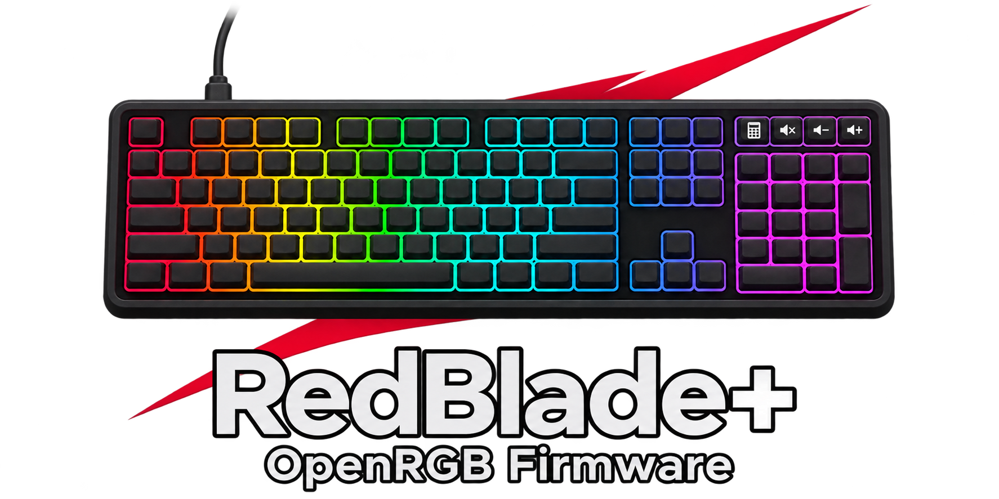
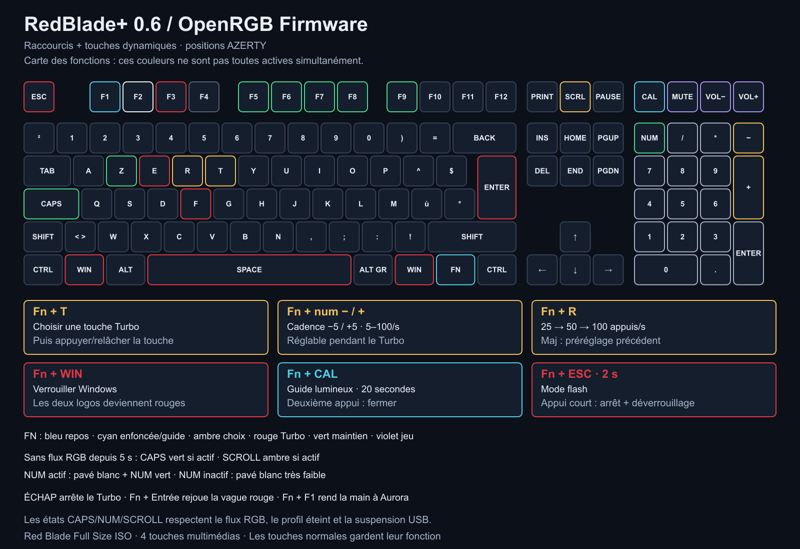

# RedBlade+ · OpenRGB Firmware

[English](README.md) · **Français**

<p align="center"></p>

<p align="center">
  <a href="https://github.com/Gaerisson/redblade-aurora-openrgb/releases/latest"></a>
  <a href="https://github.com/Gaerisson/redblade-aurora-openrgb/actions/workflows/test.yml"></a>
  <a href="LICENSE"></a>
</p>

Contrôle OpenRGB touche par touche, raccourcis Fn et fonctions de jeu pour le **Designed by GG Red Blade Full Size ISO**.

[Télécharger](https://github.com/Gaerisson/redblade-aurora-openrgb/releases/latest) · [Raccourcis](docs/SHORTCUTS.fr.md) · [Installation](docs/INSTALL.fr.md) · [Performances](docs/PERFORMANCE.md) · [Changelog](CHANGELOG.md)

## Les fonctions

| Fonction | Utilisation |
| --- | --- |
| Intégration OpenRGB native | 109 LED indépendantes par VialRGB ; Aurora passe par le SDK OpenRGB |
| Bloc Fn multimédia | Calculatrice → guide lumineux de 20 secondes, Muet → lecture/pause, Volume −/+ → piste précédente/suivante ; Maj ajoute d’autres commandes |
| Verrouillage Windows | Fn + une touche Windows ; les deux logos Windows deviennent rouges |
| Turbo au choix | Fn + T, puis une touche ; cadence réglable de 5 à 100/s avec Fn + −/+ du pavé ; préréglages E/F/Espace conservés |
| Couleurs de Fn | Bleu au repos, cyan enfoncée, ambre au choix, rouge en Turbo, vert au maintien, violet en mode jeu |
| Maintien pour avancer | Fn + Z en AZERTY / Fn + W en QWERTY ; LED verte |
| Arrêt immédiat | Échap arrête les fonctions automatiques ; Fn + Échap déverrouille aussi Windows |
| Profils lumineux locaux | Aurora/OpenRGB, blanc, rouge et éteint ; luminosité applicable aussi aux couleurs du PC |
| Secours dynamique | Sans flux RGB : Verr. Maj/Num verts, défilement ambre, pavé blanc si actif / blanc très faible sinon |
| Guide lumineux | Fn + Calculatrice éclaire les raccourcis 20 secondes ; deuxième appui pour fermer |
| Éclairage de secours | Blanc optionnel après 5 secondes sans RGB, et secours pour les quatre touches multimédias |
| Vague rouge de démarrage | Animation courbe visible de 2 secondes et fondu vers les couleurs du PC |
| Préférences au choix | Fn + F9 enregistre l’éclairage ; commandes ordinaires et flux RGB restent en RAM |
| VIA | Remappage/macros et outil de mise à jour du calque Fn avec sauvegarde |

Les fonctions automatiques sont désactivées au départ et arrêtées à la suspension/déconnexion USB. Elles ne redémarrent pas seules. Elles agissent dans l’application active : le firmware ne reconnaît pas le jeu. Un Turbo peut fonctionner avec le maintien pour avancer ; un appui normal sur la touche concernée rend la main à ton doigt.

## Cinq raccourcis pour commencer

| Raccourci | Action |
| --- | --- |
| **Fn + Windows** | Activer/désactiver le mode jeu ; les deux logos deviennent rouges |
| **Fn + E** | Démarrer/arrêter le Turbo E ; sa LED devient rouge |
| **Échap** | Arrêter Turbo et maintien pour avancer |
| **Fn + F1** | Rendre le contrôle lumineux à OpenRGB / Aurora |
| **Fn + F8** | Rétablir les réglages par défaut, arrêter les fonctions automatiques et déverrouiller Windows |

Le [guide complet des raccourcis](docs/SHORTCUTS.fr.md) explique les quatre touches, les cadences, les voyants, la sauvegarde et la récupération. À partir de la 0.6.0, **maintenir Fn + Échap pendant 2 secondes** ouvre le bootloader. Un appui court arrête les fonctions de jeu et déverrouille Windows. Les 0.4/0.5 utilisaient Fn + Maj + Échap.



[Schéma en grand](docs/assets/shortcuts.fr.svg) · [Version anglaise](docs/assets/shortcuts.png)

## Installation

| Matériel pris en charge | Valeur |
| --- | --- |
| Clavier | Red Blade **Full Size ISO**, avec pavé numérique — pas le Red Blade 75 |
| USB / contrôleur | `320F:5136` · Sonix SN32F248B |
| Éclairage | 109 LED, dont Calculatrice, Muet, Volume − et Volume + |

1. Télécharger le ZIP de la release et lire le [guide de sauvegarde/flash](docs/INSTALL.fr.md).
2. Sauvegarder VIA en privé, vérifier le bootloader et flasher le `.bin` avec SonixFlasherC.
3. Si l’ancien calque Fn de VIA a été conservé, utiliser [l’installateur Fn](docs/SHORTCUTS.md#upgrading-an-existing-via-layer) avec les clients RGB arrêtés.
4. Configurer OpenRGB/Aurora, puis choisir **Fn + F1** :

```powershell
pwsh -File tools/configure-windows.ps1 -Apply
pwsh -File tools/configure-aurora-mapping.ps1 -Apply
```

```text
Aurora / autre client SDK → OpenRGB → VialRGB → RedBlade+
```

OpenRGB fonctionne aussi sans Aurora. VIA et OpenRGB partagent l’interface Raw HID : fermer VIA pendant l’utilisation RGB. Le firmware fournit le sous-ensemble VialRGB nécessaire à OpenRGB, pas toute l’interface Vial.

## Performances et validation

- Polling USB demandé : **1 ms** ; anti-rebond eager d’origine, NKRO et horloge Sonix partagée conservés.
- Rendu par blocs de huit LED, intervalle minimal de 33 ms, indicateurs bornés et couleur Fn au repos/en activité. Turbo produit au plus une transition par passage, sans rattrapage en rafale ni attente active.
- Benchmark Windows et mesure USB en lecture seule inclus. [À lancer ce soir](docs/PERFORMANCE.md) ; les mesures du PC ne sont pas une mesure de latence physique des touches.

**La version 0.6.0 reste expérimentale ; les validations sont distinguées des tests de compilation.** La 0.5.0 a été flashée : vague, touches multimédias, Turbo au choix, cadence en cours et arrêt confirmés par l’utilisateur. Sa couleur Fn éclairait Ctrl droit ; ce décalage est corrigé ici. Sur 0.6.0, les états Verr. Maj/Num, le placement Fn, les deux Windows rouges et le guide Calculatrice sont confirmés. Les essais prolongés, la latence physique et la veille/extinction restent à mesurer. Voir [l’audit](docs/AUDIT.md), le [manifeste](dist/manifest.json) et les [tests](.github/workflows/test.yml).

Le RGB s’éteint lorsque l’USB est suspendu ou non configuré. Si le PC maintient réellement le bus USB actif après son arrêt, le firmware ne peut pas distinguer ce cas d’un logiciel RGB fermé ; cette limite est expliquée dans le [guide technique](docs/INSTALL.fr.md).

## Documentation

- [Installation complète](docs/INSTALL.fr.md) · [Référence anglaise](docs/INSTALL.md)
- [Tous les raccourcis](docs/SHORTCUTS.fr.md) · [Mesures de performances](docs/PERFORMANCE.md) · [Audit](docs/AUDIT.md)
- [Changelog en anglais](CHANGELOG.md) · [Contribuer](CONTRIBUTING.md) · [Logo et prompt](assets/LOGO.md)

Basé sur [SonixQMK épinglé](https://github.com/SonixQMK/qmk_firmware/tree/62973ee48a976c6f7cc6d4f7b198bd48a2fdfe60), avec [OpenRGB](https://github.com/CalcProgrammer1/OpenRGB) et [Aurora](https://github.com/Aurora-RGB/Aurora). Code ajouté sous GPL-2.0-or-later ; licences et sources amont conservées. [Licence](LICENSE).
