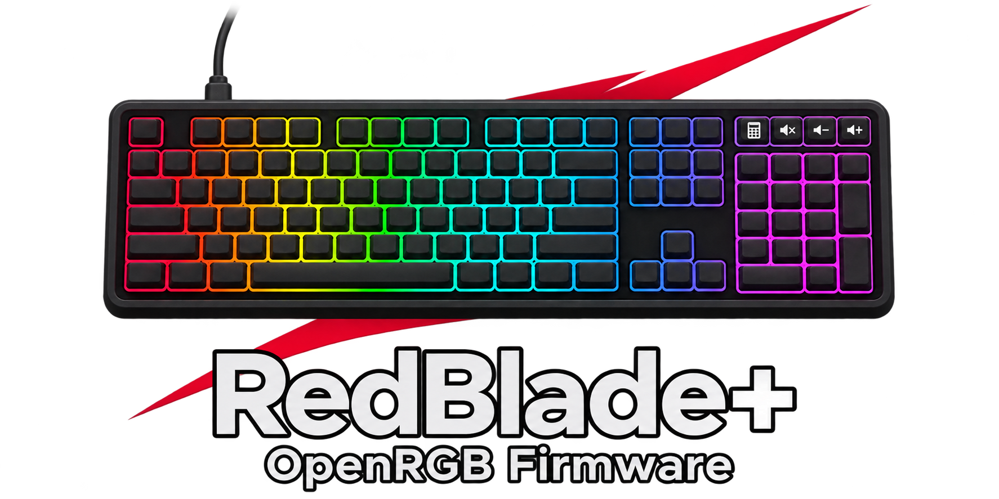

# RedBlade+ · OpenRGB Firmware

**English** · [Français](README.fr.md)

<p align="center"></p>

<p align="center">
  <a href="https://github.com/Gaerisson/redblade-aurora-openrgb/releases/latest"></a>
  <a href="https://github.com/Gaerisson/redblade-aurora-openrgb/actions/workflows/test.yml"></a>
  <a href="LICENSE"></a>
</p>

Per-key OpenRGB lighting, useful Fn shortcuts and game helpers for the **Designed by GG Red Blade Full Size ISO**.

[Download](https://github.com/Gaerisson/redblade-aurora-openrgb/releases/latest) · [Shortcuts](docs/SHORTCUTS.md) · [Install](docs/INSTALL.md) · [Performance](docs/PERFORMANCE.md) · [Changelog](CHANGELOG.md)

## What you get

| Feature | How it works |
| --- | --- |
| Native OpenRGB integration | 109 independently controlled LEDs through VialRGB; Aurora connects through the OpenRGB SDK |
| A useful Fn media deck | Calculator → Game Mode, Mute → play/pause, Volume −/+ → previous/next; Shift adds more controls |
| Windows-key lock | Fn + Calculator or Fn + Windows; red Calculator LED while enabled |
| Turbo E, F or Space | Toggle repeat with Fn + the key; red active LED; target rates of 25/50/100 presses/s |
| Forward hold | Fn + W on QWERTY / Fn + Z on AZERTY; green active LED |
| Immediate stop | Esc stops game helpers; Fn + Esc also unlocks Windows |
| Local lighting profiles | Host, white, red and Off; brightness works with host colors too |
| White fallback | Optional white after 5 seconds without RGB, plus fallback for all four media keys |
| Red startup wave | Curved 1.5-second wave and smooth handover to the latest host colors |
| Preferences you control | Fn + F9 saves lighting settings; regular controls and RGB streaming stay RAM-only |
| VIA support | Remapping/macros, with a backed-up Fn-layer upgrade tool |

Game helpers start disabled, stop on USB suspension/disconnection and never resume automatically. They act on the active application; the firmware cannot detect game focus. One Turbo target can run alongside forward hold. Normal presses of a helper's target key give control back to your finger.

## Five shortcuts to learn first

| Shortcut | Action |
| --- | --- |
| **Fn + Calculator** | Toggle Game Mode |
| **Fn + E** | Start/stop Turbo E; E turns red |
| **Esc** | Stop Turbo and forward hold |
| **Fn + F1** | Give lighting control back to OpenRGB / Aurora |
| **Fn + F8** | Restore defaults, stop helpers and unlock Windows |

The [full shortcut guide](docs/SHORTCUTS.md) covers the four-key deck, rate selection, indicators, saving, recovery and bootloader entry. **Fn + Shift + Esc held for 2 seconds** enters the bootloader on version 0.4.0+; older firmware may still use Fn + Esc immediately.

## Getting started

| Supported hardware | Value |
| --- | --- |
| Keyboard | Red Blade **Full Size ISO**, with numpad — not the Red Blade 75 |
| USB / MCU | `320F:5136` · Sonix SN32F248B |
| Lighting | 109 LEDs, including Calculator, Mute, Volume − and Volume + |

1. Download the release ZIP and read the [backup and flash guide](docs/INSTALL.md#backup-and-flashing).
2. Back up your VIA layout privately, identify the correct bootloader and flash the included `.bin` with SonixFlasherC.
3. If an older VIA Fn layer survived, use the [Fn-layer installer](docs/SHORTCUTS.md#upgrading-an-existing-via-layer) while RGB clients are stopped.
4. Configure OpenRGB/Aurora, then choose **Fn + F1**:

```powershell
pwsh -File tools/configure-windows.ps1 -Apply
pwsh -File tools/configure-aurora-mapping.ps1 -Apply
```

```text
Aurora / another SDK client → OpenRGB → VialRGB → RedBlade+
```

OpenRGB also works without Aurora. VIA and OpenRGB share Raw HID; close VIA during normal RGB use. The firmware provides the VialRGB subset needed by OpenRGB, not the complete Vial configuration UI.

## Performance and validation

- Requested USB polling: **1 ms**; factory eager debounce, NKRO and the shared Sonix scan/PWM timer are preserved.
- RGB work is split into eight-LED chunks with a 33 ms minimum frame interval. Status overlays are bounded and skipped when unused. Turbo schedules at most one edge per housekeeping pass; no catch-up queue or busy wait.
- A Windows native benchmark and read-only USB timing tool are included. [Run them tonight](docs/PERFORMANCE.md); host timings are not physical key-latency measurements.

**0.4.0 is experimental, build- and host-tested.** Its new shortcuts/game helpers have not yet been verified on the target keyboard. Earlier hardware verification covered version 0.1.0, typing, mapping and Aurora colors. See the [audit](docs/AUDIT.md), [manifest](dist/manifest.json) and [test workflow](.github/workflows/test.yml) for the exact scope.

The keyboard turns its RGB off when USB is suspended or unconfigured. A host that keeps the USB bus genuinely active after shutdown cannot be distinguished from an application that stopped sending colors; see the [USB power limitations](docs/INSTALL.md#fallback-lighting-and-red-wave--040).

## Project files

- [Installation and technical reference](docs/INSTALL.md) · [French reference](docs/INSTALL.fr.md)
- [All shortcuts](docs/SHORTCUTS.md) · [Performance tools](docs/PERFORMANCE.md) · [Code audit](docs/AUDIT.md)
- [Changelog](CHANGELOG.md) · [Contributing](CONTRIBUTING.md) · [Logo and generation prompt](assets/LOGO.md)

Based on pinned [SonixQMK](https://github.com/SonixQMK/qmk_firmware/tree/62973ee48a976c6f7cc6d4f7b198bd48a2fdfe60), with native [OpenRGB](https://github.com/CalcProgrammer1/OpenRGB) / [Aurora](https://github.com/Aurora-RGB/Aurora) integration. Added code is GPL-2.0-or-later; upstream notices and corresponding sources are retained. [License](LICENSE).
