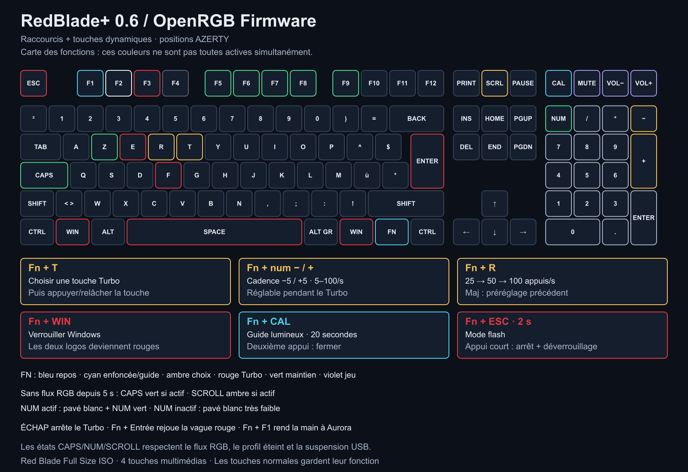

# Raccourcis RedBlade+

[English](SHORTCUTS.md) · [Projet](../README.fr.md) · [Installation](INSTALL.fr.md)

Guide pour **RedBlade+ 0.6.0**. Fn se trouve entre Windows droite et Ctrl droit. Les touches normales, le pavé numérique et les quatre touches multimédias gardent leur rôle habituel sans Fn.

## Répéter une touche : exemple avec G

1. Appuie sur **Fn + T**, puis relâche les deux touches. Fn clignote en **ambre** : tu as 10 secondes pour choisir.
2. Appuie sur **G**, puis relâche G. Ce choix ne tape rien ; le Turbo démarre au relâchement. G et Fn deviennent **rouges**.
3. Pendant le Turbo, **Fn + − du pavé numérique** ralentit de 5 appuis/s ; **Fn + + du pavé numérique** accélère de 5. La cible va de **5 à 100 appuis/s**, avec **50 par défaut**. Ces réglages fonctionnent aussi avant de démarrer.
4. **Échap** arrête immédiatement. Tu peux aussi utiliser **Fn + Échap**, **Fn + T**, ou appuyer normalement sur la touche répétée. Fn + T pendant un Turbo l'arrête sans lancer un nouveau choix.

**Fn + R** parcourt les préréglages **25 → 50 → 100** ; **Fn + Maj + R** parcourt le sens inverse. Changer la cadence conserve la touche choisie et n'interrompt pas le Turbo. La cadence est une cible : le jeu et le bus USB peuvent traiter moins d'événements.

Tu peux choisir une lettre, un chiffre, un signe, F1–F12, une flèche, une touche de navigation ou du pavé numérique. Le choix utilise le remappage **VIA de la couche de base**, même si Fn reste enfoncée : choisir F1 répète donc F1 au lieu de changer de profil lumineux. Fn, les modificateurs, Échap, les commandes système/alimentation, les touches multimédias et les macros ne sont pas des cibles. Les modificateurs restent utilisables et s'appliquent aux répétitions.

Commence dans le Bloc-notes. Le clavier ne connaît pas l'application active : le Turbo continue si tu changes de fenêtre. Il s'arrête à la suspension/déconnexion USB et ne redémarre jamais seul.

## Raccourcis de jeu

| Raccourci | Action |
| --- | --- |
| Fn + E / F / Espace | Démarrer/arrêter le Turbo de cette touche ; LED rouge |
| Fn + T, puis une touche | Choisir une cible ; Fn + T arrête un Turbo déjà actif |
| Fn + − / + du pavé numérique | Cadence −5 / +5, de 5 à 100 appuis/s |
| Fn + R / Fn + Maj + R | Préréglage suivant / précédent : 25, 50, 100 |
| Fn + Z en AZERTY / Fn + W en QWERTY | Maintenir la touche pour avancer ; LED verte |
| Fn + une touche Windows | Verrouiller/déverrouiller Windows ; les deux logos deviennent rouges |
| Fn + Maj + une touche Windows | Déverrouiller Windows |
| Fn + Calculatrice | Guide lumineux 20 secondes ; deuxième appui pour fermer |
| Échap | Arrêter Turbo et maintien ; Échap est envoyé à l'application |
| Fn + Échap | Arrêter les fonctions de jeu et déverrouiller Windows ; aucun Échap envoyé |

Un seul Turbo peut fonctionner, avec le maintien pour avancer en parallèle. S'ils ciblent la même touche d'avancée, la nouvelle fonction remplace l'ancienne. Un appui normal sur une cible rend la main à ton doigt. Le mode jeu bloque les touches Windows et les raccourcis QMK simples utilisant Windows ; il ne filtre pas toutes les macros VIA ou actions avancées.

## Couleur de Fn

| Couleur | Signification |
| --- | --- |
| Bleu discret | Au repos |
| Cyan | Fn enfoncée ou guide visible, sans fonction prioritaire |
| Ambre clignotant | Choix d'une touche Turbo ou attente de son relâchement |
| Rouge | Turbo actif ; la cible est rouge aussi |
| Vert | Maintien pour avancer, sans Turbo |
| Violet | Mode jeu actif, sans fonction automatique et Fn relâchée |

L'ordre de priorité est choix → Turbo → maintien → Fn enfoncée/guide → mode jeu → repos. Avec Fn enfoncée, T est ambre ; R et −/+ du pavé montrent la plage de cadence : vert à 5–25, ambre à 30–50, rouge à 55–100. Ces couleurs sont celles du **rétroéclairage RGB de la touche Fn**. Le voyant Fn séparé de la carte est monochrome et garde son fonctionnement allumé/éteint.

Tous les indicateurs RGB respectent l'extinction, la luminosité zéro et la suspension USB. Les commandes d'arrêt fonctionnent même sans lumière.

## Les quatre touches en haut à droite

| Touche | Seule | Avec Fn | Avec Fn + Maj |
| --- | --- | --- | --- |
| Calculatrice | Calculatrice | Guide lumineux 20 secondes | Fermer le guide |
| Muet | Couper/remettre le son | Lecture/pause | Arrêter la lecture |
| Volume − | Baisser le volume | Piste précédente | Baisser la luminosité |
| Volume + | Monter le volume | Piste suivante | Monter la luminosité |

Si Aurora les laisse noires, un blanc discret les éclaire. Fn + F6 active/désactive ce secours. Une couleur non noire du PC garde la priorité, sauf un indicateur temporaire du firmware. L'extinction globale et la suspension USB restent prioritaires.

## Éclairage et sauvegarde

| Raccourci | Action |
| --- | --- |
| Fn + F1 / F2 / F3 / F4 | Aurora/OpenRGB / blanc / rouge / éteint |
| Fn + Retour arrière | Éteindre/rétablir le profil précédent |
| Fn + Page haut ou flèche droite | Augmenter la luminosité |
| Fn + Page bas ou flèche gauche | Diminuer la luminosité |
| Fn + flèche haut / bas | Profil suivant / précédent |
| Fn + Entrée | Rejouer la vague rouge de 2 secondes, puis revenir au profil |
| Fn + F5 | Vague automatique au démarrage/reprise : oui/non |
| Fn + F6 | Secours blanc des quatre touches multimédias : oui/non |
| Fn + F7 | Sans données RGB pendant 5 secondes : blanc/éteint |
| Fn + F8 | Réglages par défaut, arrêt des fonctions de jeu, Windows déverrouillé, cadence 50/s |
| Fn + F9 | Enregistrer les préférences lumineuses ; Calculatrice verte brièvement |
| Fn + Pause | Arrêter la lecture multimédia |

Fn + F9 enregistre seulement le profil, la luminosité et les options lumineuses. Le Turbo, son choix/cadence, le maintien et le mode jeu restent temporaires. Les commandes ordinaires et le flux RGB n'écrivent pas en EEPROM. Fn + F8 ne supprime pas les touches/macros VIA.

## Éclairage dynamique sans logiciel RGB

Dans le profil Aurora/OpenRGB, après **5 secondes sans données RGB**, le blanc de secours indique aussi l’état des verrouillages :

| État | Rétroéclairage |
| --- | --- |
| Verr. Maj actif | La touche Verr. Maj devient verte ; les deux Maj restent inchangées |
| Verr. Maj inactif | Verr. Maj reste blanche |
| Verr. Num actif | Les 17 touches du pavé sont blanches, avec Verr. Num en vert |
| Verr. Num inactif | Tout le pavé devient blanc très faible, valeur linéaire 8/255 |
| Verr. défilement actif | La touche défilement devient ambre |

Un nouveau flux RGB reprend immédiatement la priorité sur ces états : ils ne recolorent pas les effets d’Aurora. Les profils locaux blanc/rouge et les effets autonomes sont conservés. Éteint, luminosité zéro, secours sombre et suspension USB restent prioritaires. Verr. Num inactif ne désactive pas physiquement les touches : le firmware en indique simplement l’état.

**Fn + Calculatrice** est le guide lumineux : les autres touches s’atténuent et les commandes Fn s’éclairent selon leur rôle. Fn devient cyan. Un deuxième appui, Échap ou l’expiration des **20 secondes** ferme le guide. **Fn + Maj + Calculatrice** le ferme aussi. Cela ne verrouille pas Windows, ne démarre pas le Turbo et ne sauvegarde rien. Calculatrice seule garde son rôle normal.

## Mise à jour et bootloader

Sur RedBlade+ 0.6.0 et versions suivantes, maintiens **Fn + Échap pendant 2 secondes**. Relâcher Fn ou Échap annule. **Fn + Échap seul reste la commande d'arrêt.**

Si un ancien calque Fn est conservé après le flash, ferme OpenRGB, Aurora et VIA puis lance l'[installateur avec sauvegarde](SHORTCUTS.md#upgrading-an-existing-via-layer). La version 0.6.0 installe 33 raccourcis sur la couche Fn et conserve les touches de base et les macros.

Les versions 0.4/0.5 utilisaient Fn + Maj + Échap pendant 2 secondes. Sur 0.6.0, Maj reste acceptée mais n’est plus nécessaire. Un appui court Fn + Échap arrête les fonctions de jeu et déverrouille Windows ; il faut maintenir les deux touches pour flasher.
