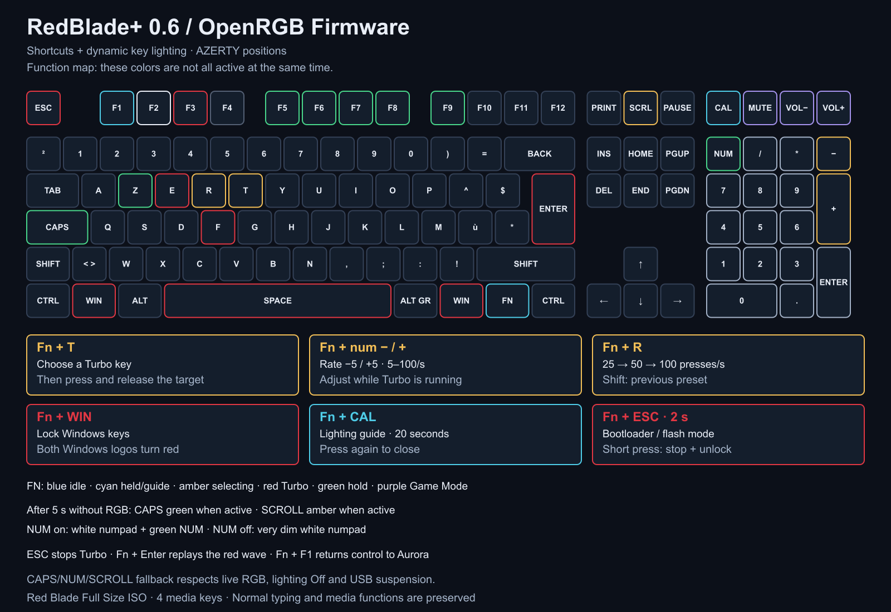

# RedBlade+ shortcuts

[Français](SHORTCUTS.fr.md) · [Project](../README.md) · [Installation](INSTALL.md) · [Performance checks](PERFORMANCE.md)

These are the **default firmware 0.6.0 bindings**. Fn is the key between Right Windows and Right Ctrl. Base-layer typing, Calculator, Mute and Volume keys retain their usual behavior.

If an older VIA Fn layer was preserved when flashing, install the new bindings with the backed-up [Fn layer installer](#upgrading-an-existing-via-layer). The checked machine-readable map is [fn-shortcuts.json](../fn-shortcuts.json).

## Start here

1. **Fn + either Windows key** toggles Game Mode. Both Windows logos glow red while locked. **Fn + Calculator** opens the 20-second shortcut-lighting guide.
2. **Fn + E** starts repeating E. Its LED turns red. Press the same shortcut again to stop.
3. **Esc** immediately stops Turbo and forward hold. **Fn + Esc** also unlocks Windows keys.
4. **Fn + F1** restores OpenRGB control. **Fn + F8** restores the default lighting settings and stops game helpers.

The firmware cannot detect game focus: helpers send keys to the active application. They start disabled and stop on USB suspension/disconnection. They never resume automatically.

## The four keys above the numpad

| Key | Normal | With Fn | With Fn + Shift |
| --- | --- | --- | --- |
| Calculator | Open calculator | Toggle the 20-second lighting guide | Close the guide |
| Mute | Toggle audio mute | Play / pause | Stop playback |
| Volume − | Lower volume | Previous track | Dim keyboard lighting |
| Volume + | Raise volume | Next track | Brighten keyboard lighting |

With Fn held, these four LEDs show their secondary roles. Game Mode keeps both Windows logos red. Indicators respect lighting Off, zero brightness and USB suspension.

## Game helpers

### Repeat a key of your choice

1. Press **Fn + T**, then release both keys. Fn blinks amber: selection is armed for 10 seconds.
2. Press and release the key to repeat, for example G, F1, an arrow or a numpad key. The selection itself does not type; repetition starts when you release the chosen key. The chosen key and Fn turn red.
3. While it repeats, use **Fn + numpad − / +** to decrease/increase the target by **5 presses/s**, from **5 to 100/s**. It starts at **50/s**. **Fn + R** still cycles the 25/50/100 presets; Shift reverses them. You can adjust the rate before starting too.
4. **Esc**, **Fn + Esc**, **Fn + T**, or a normal press of the target stops Turbo. Fn + T while Turbo is running stops it without arming another selection.

Keeping Fn held while choosing also works: the firmware uses the selected key's **VIA base-layer assignment**, so choosing F1 repeats F1 rather than changing the lighting profile. Ordinary letters, digits, punctuation, function keys, arrows, navigation and numpad keys are supported. Fn/layer actions, modifiers, Esc, power/sleep/system actions, consumer/media actions and macros are not repeat targets. Modifiers still work normally and apply to repeated keys. Choose a basic key rather than a QMK macro or mod-tap remap.

The E/F/Space shortcuts below remain convenient presets. Only one repeat target can run. Test in a text editor before using another application.

| Shortcut | Action | Active indicator |
| --- | --- | --- |
| Fn + E | Toggle Turbo E | E turns red |
| Fn + F | Toggle Turbo F | F turns red |
| Fn + Space | Toggle Turbo Space | Space turns red |
| Fn + T, then a key | Select a repeat target; while running, Fn + T stops it | Fn blinks amber during selection, then Fn/target turn red |
| Fn + numpad − / + | Change target cadence by −5 / +5 presses/s, within 5–100 | Works while Turbo runs; does not send the volume or numpad key |
| Fn + W (QWERTY) / Fn + Z (AZERTY) | Toggle forward-key hold | That key turns green |
| Fn + R | Next Turbo rate: 25 → 50 → 100 presses/second | Hold Fn: R is green / amber / red |
| Fn + Shift + R | Previous Turbo rate | Same rate colors |
| Esc | Stop Turbo and forward hold; Escape still reaches the application | Helper indicators clear |
| Fn + Esc | Stop helpers and unlock Windows; no Escape is sent | Helper/Game indicators clear |

**Default Turbo rate: 50 presses/second.** One Turbo target runs at a time; choosing another switches the target. Forward hold can run alongside Turbo. When both would generate the forward usage, the new helper replaces the old one. A normal physical press of the repeated/held target cancels that helper and gives control back to your finger.

Turbo sends alternating key-down/key-up reports, rather than changing Windows repeat settings. It schedules at most one edge per housekeeping pass and drops missed deadlines instead of sending catch-up bursts. Fractional millisecond intervals are distributed without division in the scheduler; changing cadence does not restart or change the selected target. Rates are targets; effective actions depend on USB scheduling and the application. Current keyboard modifiers still apply.

### Fn backlight status

| Fn color | Meaning |
| --- | --- |
| Dim blue | Idle |
| Cyan | Fn held or shortcut guide active, with no higher-priority helper status |
| Blinking amber | Waiting for a Turbo choice or its release |
| Red | Turbo running; the target is also red |
| Green | Forward hold active, with no Turbo |
| Purple | Game Mode active, with no helper and Fn released |

Priority is selection → Turbo → forward hold → Fn held/guide → Game Mode → idle. With Fn held, T glows amber and R/numpad −/+ indicate the cadence range: green at 5–25, amber at 30–50, red at 55–100. Both Windows logos indicate Game Mode. Calculator indicates the guide and briefly confirms explicit Save. These are the **RGB backlights**; the separate Fn indicator driven by the board's single GPIO remains a single-color on/off light. RGB status respects Off, brightness zero and USB suspension.

W/Z refers to the same physical forward-key position and USB usage. The firmware does not know the host language layout. The E, F, R and Space positions are identical on the usual French AZERTY and QWERTY layouts.

Game Mode blocks standalone left/right Windows keys and simple GUI-modified QMK shortcuts. It clears already-held GUI modifiers when enabled, without clearing Ctrl/Alt/Shift. It is not a filter for arbitrary VIA macros or every advanced modifier action. Game Mode is not saved and exits on USB suspension/disconnection.

## Lighting and preferences

| Shortcut | Action |
| --- | --- |
| Fn + F1 | OpenRGB / Aurora host profile |
| Fn + F2 | Local white profile |
| Fn + F3 | Local red profile |
| Fn + F4 | Lighting Off |
| Fn + Backspace | Toggle lighting Off / previous profile |
| Fn + Page Up / Right | Increase master brightness |
| Fn + Page Down / Left | Decrease master brightness |
| Fn + Up / Down | Next / previous profile: host, white, red |
| Fn + Enter | Replay the 2-second red wave, then return to the selected profile |
| Fn + F5 | Enable / disable automatic startup and resume waves |
| Fn + F6 | Enable / disable white fallback for the four media keys |
| Fn + F7 | Choose white / dark after 5 seconds without RGB data |
| Fn + F8 | Restore RAM defaults, stop helpers, unlock Windows, reset Turbo to 50/s |
| Fn + F9 | Save lighting preferences; Calculator briefly turns green if lighting is on |
| Fn + Pause | Stop media playback |
| Fn + either Windows key | Toggle Game Mode; both Windows logos turn red |
| Fn + Shift + either Windows key | Unlock Windows |
| Fn + Calculator | Toggle a 20-second shortcut-lighting guide; press again or Esc to close |

Local white/red profiles keep their colors even while OpenRGB sends updates. Returning to the host profile uses fresh host colors; old timed-out colors are cleared. Brightness applies to host colors, local profiles, the wave and status indicators. At zero brightness everything in the RGB backlight is dark; Fn + F8 is the recovery shortcut.

Ordinary shortcuts and RGB streaming do not write EEPROM. **Fn + F9 is the explicit save action.** It stores only lighting profile, brightness and the three lighting options in QMK's user preference word. It does not save Game Mode, Turbo, forward hold, VIA layers or macros. Fn + F8 changes RAM defaults; press Fn + F9 afterward if you want those defaults saved too. Flashing may erase preferences.

## Dynamic fallback and the lighting guide



With the host profile selected, after **5 seconds without RGB packets**, the white fallback gains these indicators:

| State | Backlight |
| --- | --- |
| Caps Lock on | Caps Lock key green; Shift keys remain unchanged |
| Caps Lock off | Caps Lock key white |
| Num Lock on | All 17 numpad keys white; Num Lock itself green |
| Num Lock off | Entire numpad very dim white (linear value 8/255); it does not disable the physical keys |
| Scroll Lock on | Scroll Lock key amber |

Fresh RGB data immediately takes priority over these Caps/Num/Scroll overlays. They do not replace native standalone effects or a chosen local white/red profile. Off, zero master brightness, the dark-idle setting and USB suspension remain authoritative. The four media fallback lights remain available separately.

**Fn + Calculator** temporarily dims other keys and colors the available Fn controls. Fn becomes cyan. Press it again, use Esc, or wait **20 seconds** to return to the selected profile. Shift + Fn + Calculator closes the guide. This action does not change the Windows lock, start Turbo or save preferences. Normal Calculator still opens Calculator. Guide colors are shown in the map above; the complete tables explain each key. Fn + R selects 25/50/100 presets; the numpad −/+ controls perform live fine adjustment.

## Bootloader

**Hold Fn + Esc for 2 seconds** to enter the bootloader on RedBlade+ 0.6.0+. Releasing Fn or Esc early cancels the request. Pressing the shortcut immediately stops helpers/unlocks Windows; a short press does only that. Fn + Shift + Esc remains an alias, but Shift is no longer needed.

Versions 0.4/0.5 require Fn + Shift + Esc held for two seconds. Version 0.1 may enter the bootloader immediately with Fn + Esc. Confirm which firmware is currently installed before following the flash guide. No shortcut here resets VIA layers or erases macros.

## Upgrading an existing VIA layer

Stop OpenRGB, Aurora and VIA, then run from the project root:

```powershell
python tools/install-fn-layer.py
python tools/install-fn-layer.py --apply --backup C:\private-path\before-redblade-plus.json
```

The first command is a dry run. Applying requires RedBlade+ 0.6.0+, creates a complete private VIA backup before the first write, changes only the 33 published bindings on layer 1, verifies each write and attempts rollback after an error. Base keys, macros and other Fn bindings are retained. Do not upload personal VIA backups to an issue.
